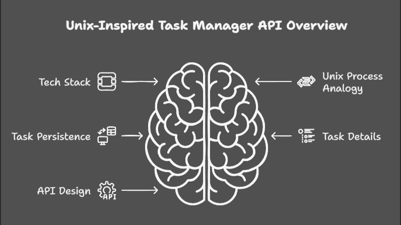

[](https://github.com/)
[](https://opensource.org/licenses/MIT)
[](https://github.com/)

# TaskManager API

Una aplicación web orientada a la gestión eficiente de tareas y proyectos mediante una interfaz limpia y endpoints RESTful optimizados.

---

## Tabla de Contenidos

- [Descripción](#descripción-del-proyecto)
- [Tecnologías Utilizadas](#tecnologías-utilizadas)
- [Funcionalidades](#funcionalidades)
- [Vista Previa](#vista-previa)
- [Arquitectura del Sistema](#arquitectura-del-sistema)
- [Instrucciones de Instalación](#instrucciones-de-instalación)
- [Ejemplo de Uso](#ejemplo-de-uso)

---

## Tecnologías Utilizadas

| Tecnología | Descripción |
| :--- | :--- |
| **Node.js** | Entorno de ejecución para JavaScript |
| **Express** |  Framework web para la API |
| **Mermaid** | Generación de diagramas mediante código |
| **Markdown** | Lenguaje de marcado para documentación |

---

## Funcionalidades

- [x] Registro e inicio de sesión de usuarios
- [x] Creación, edición y eliminación de tareas 
- [x] Categorización por etiquetas y prioridades
- [ ] Integración con notificaciones por correo electrónico
- [ ] Exportación de reportes en PDF

---

## Vista Previa



---

## Arquitectura del Sistema

```mermaid
graph TD
    A[Usuario] -->|Petición HTTP| B(Frontend / UI)
    B -->|API REST| C[Servidor Express]
    C -->|Consulta| D[(Base de Datos)]
    D -->|Respuesta| C
    C -->|JSON| B